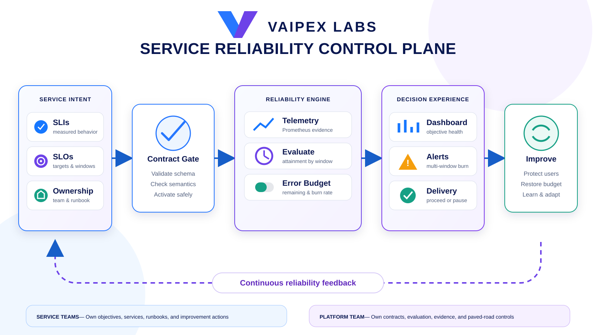

# Vaipex Service Reliability Control Plane

An open reference implementation for turning service-level indicators into
clear reliability objectives, actionable error budgets, and evidence-based
delivery decisions.

Developed by **Vaipex Labs** for the developer and platform engineering
community.


[Project at a Glance](#project-at-a-glance) ·
[Reliability Model](#reliability-model) ·
[Reliability Contract](#reliability-contract) ·
[Delivery Flow](#delivery-flow) ·
[Two-Minute Demo](#two-minute-demo) ·
[Delivery Roadmap](#delivery-roadmap)

## Project at a Glance

| Area | Capability |
| --- | --- |
| Reliability contracts | Version-controlled SLIs, SLO targets, evaluation windows, and ownership |
| Objective evaluation | Consistent availability and latency calculations from service telemetry |
| Error budgets | Remaining budget, consumption, and burn-rate signals for each objective |
| Delivery decisions | Explainable proceed, caution, or pause recommendations based on reliability evidence |
| Operational response | Fast- and slow-burn alerts connected to dashboards and runbooks |
| Developer experience | A reproducible local journey with safe defaults and automated validation |
| Governance | Service-level accountability without using individual productivity measures |

## Why This Project Exists

Teams frequently collect metrics without agreeing on what reliable service
means. The result is noisy alerting, subjective release decisions, and a gap
between product expectations and operational behavior.

This project demonstrates a platform-owned reliability model: teams define
objectives through a documented contract, the platform evaluates those
objectives consistently, and the resulting error-budget evidence guides
delivery and improvement decisions. The control plane informs decisions; it
does not hide the evidence or replace accountable human ownership.

## Reliability Model

| Term | Plain-language meaning | Example |
| --- | --- | --- |
| SLI | What the system measures | Proportion of successful requests |
| SLO | The reliability target for an SLI | 99.9% successful requests over 30 days |
| Error budget | The unreliability allowed by the SLO | 0.1% of requests may fail in that window |
| Burn rate | How quickly the error budget is being consumed | A burn rate of 2 consumes budget twice as fast as planned |
| SLA | An external commitment and its consequences | A contractual 99.9% availability commitment |

SLIs and SLOs are operational engineering tools. An SLA is a business or
customer commitment and should normally be informed by—rather than used as a
substitute for—the internal reliability model.

## Reliability Contract

Service teams declare reliability intent through a strict, versioned
`ServiceReliability` document. The contract connects ownership and runbooks to
availability and latency objectives, Prometheus-compatible evidence,
multi-window burn-rate alerts, and explainable delivery policy thresholds.

- Start with the [checkout-service example](contracts/examples/checkout-service.yaml).
- Inspect the portable [JSON Schema](contracts/service-reliability.schema.json).
- Read the [contract semantics and design boundaries](docs/reliability-contract.md).

The interface is telemetry-adapter oriented. The reference implementation
starts with Prometheus and PromQL while preserving a stable good-events /
total-events model that another provider can implement.

### Validate a contract

Run the validator directly:

```bash
go run ./cmd/reliabilityctl validate contracts/examples/checkout-service.yaml
```

Expected result:

```text
valid: contracts/examples/checkout-service.yaml (service=checkout-service objectives=2)
```

Or run the complete contract gate, which also proves that representative
structural and semantic failures are rejected:

```bash
./scripts/validate-contracts.sh
```

The validator accepts YAML or JSON, uses the embedded canonical schema, checks
URI formats, and then applies rules that JSON Schema cannot express clearly:
unique identifiers, duration ordering, supported telemetry adapters, PromQL
syntax, and consistent delivery thresholds. Failures identify the exact field
path and return a non-zero exit code suitable for local hooks or CI.

## Delivery Flow



1. A service owner declares supported SLIs, SLO targets, evaluation windows,
   ownership, and runbook metadata in a version-controlled contract.
2. Automated validation checks the contract before it becomes active.
3. Prometheus-compatible telemetry supplies request and latency evidence.
4. The reliability engine evaluates objective attainment, remaining error
   budget, and burn rate from the same transparent definitions.
5. Dashboards, alerts, and a decision API expose both the outcome and its
   supporting evidence.
6. Delivery workflows use that evidence to proceed, exercise caution, or pause
   while teams restore reliability.
7. Teams improve the service or its operating model and observe the result
   through the next evaluation cycle.

## Two-Minute Demo

The completed reference implementation will provide one command:

```bash
./scripts/two-minute-demo.sh
```

The journey will create representative traffic, evaluate availability and
latency objectives, show error-budget consumption, demonstrate a burn-rate
alert, and return an explainable delivery recommendation. Each capability will
be added and verified through the milestones below.

## Delivery Roadmap

- [x] Establish the open-source repository, project narrative, reliability
  vocabulary, standard flow, and Apache 2.0 license.
- [x] Define a provider-neutral, versioned reliability contract for services,
  SLIs, SLOs, ownership, and evaluation windows.
- [x] Build contract validation with clear feedback and representative valid
  and invalid examples.
- [ ] Implement the SLO evaluator and error-budget calculation engine.
- [ ] Add reproducible service telemetry and Prometheus-based evidence.
- [ ] Add multi-window burn-rate alerts, dashboards, and linked runbooks.
- [ ] Add an explainable reliability decision interface for delivery systems.
- [ ] Automate validation and the complete two-minute journey in CI.
- [ ] Polish security, operations, contribution, and adoption guidance.

## Planned Repository Map

```text
.
├── .github/workflows/       # Contract and end-to-end validation
├── cmd/                     # Reliability control-plane entry points
├── contracts/               # Versioned service reliability definitions
├── dashboards/              # Reliability and error-budget views
├── deploy/                  # Reproducible local platform configuration
├── docs/                    # Architecture, operations, and adoption guidance
├── examples/                # Representative services and objectives
├── internal/                # Evaluation and decision logic
├── rules/                   # Recording and burn-rate alert rules
└── scripts/                 # Setup, validation, demo, and cleanup workflows
```

The map communicates the intended product boundaries. Directories are created
only when their corresponding milestone delivers a working capability.

## Design Principles

- Reliability definitions are explicit, versioned, reviewable, and owned.
- Every status and recommendation is traceable to objective evidence.
- Missing or stale telemetry is reported as unknown, never healthy.
- Alerting focuses on meaningful error-budget consumption rather than isolated
  threshold noise.
- Delivery controls are transparent, reversible, and configurable by policy.
- The reference implementation remains provider-neutral where practical.
- Signals describe services and systems, never individual performance.

## License

Licensed under the [Apache License 2.0](LICENSE).
